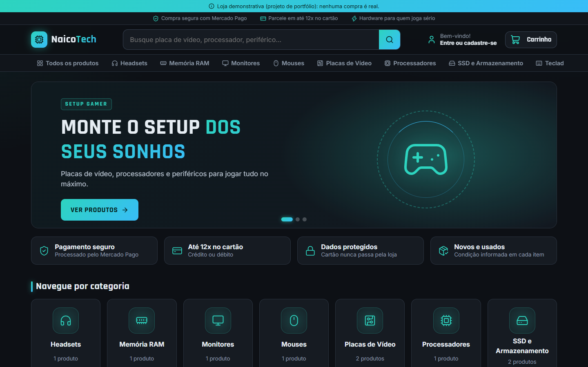
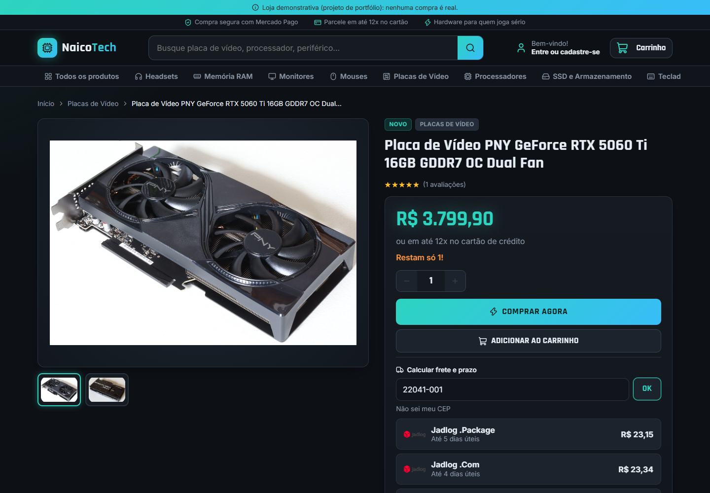
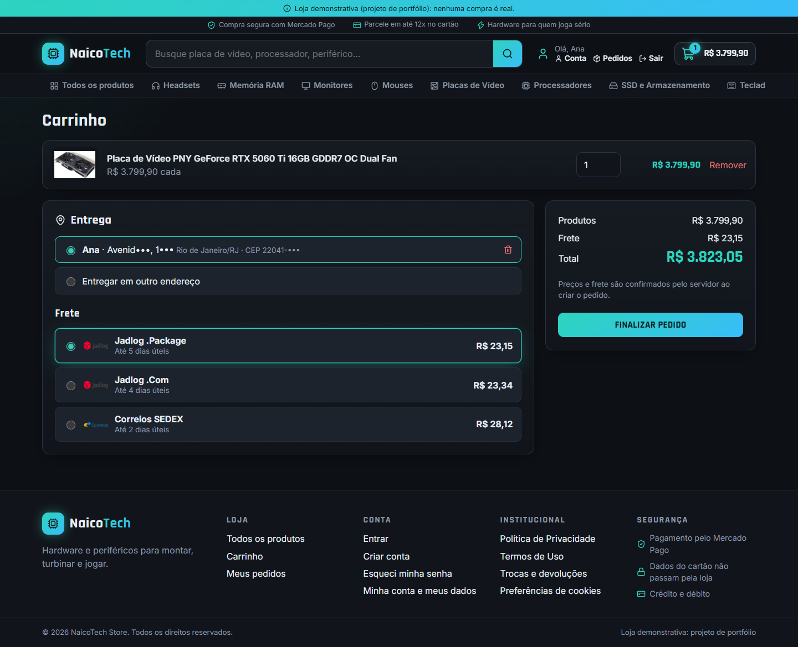
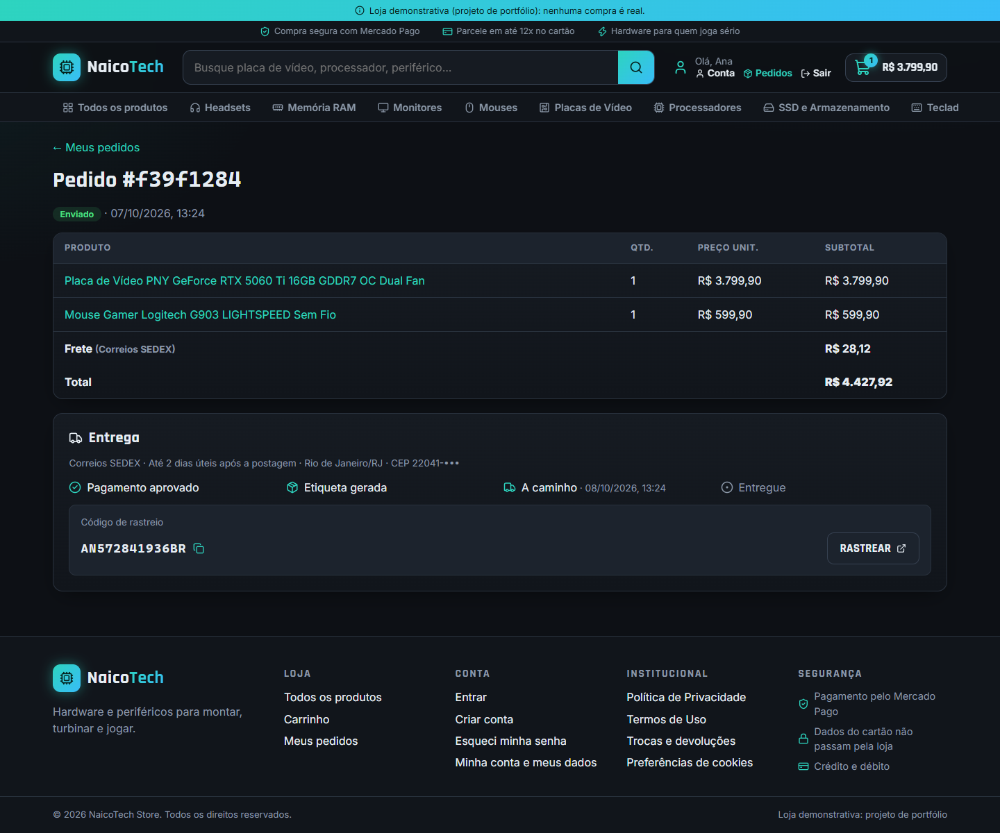
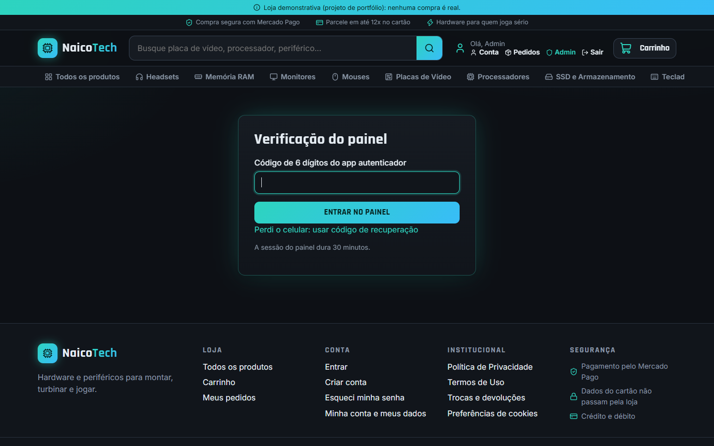
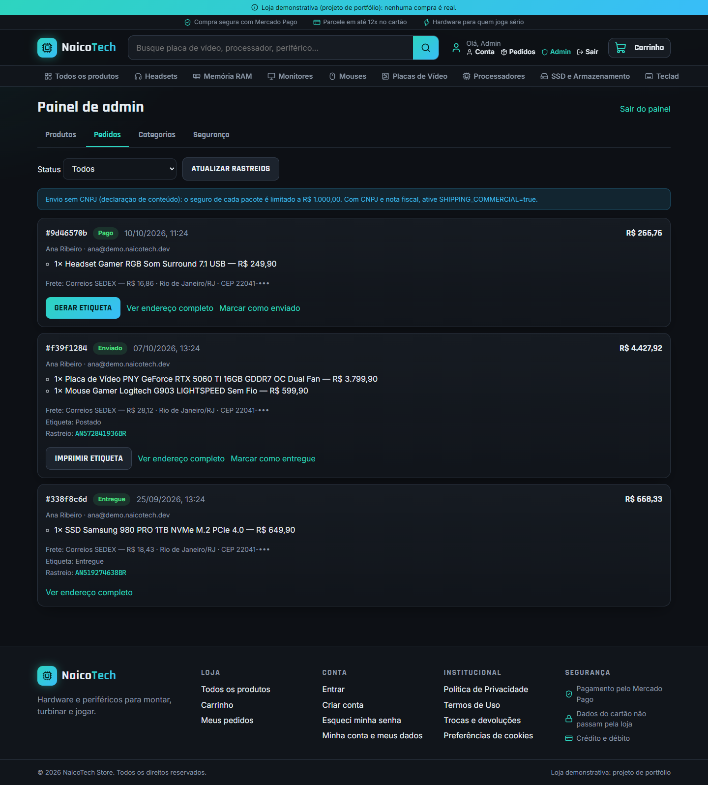
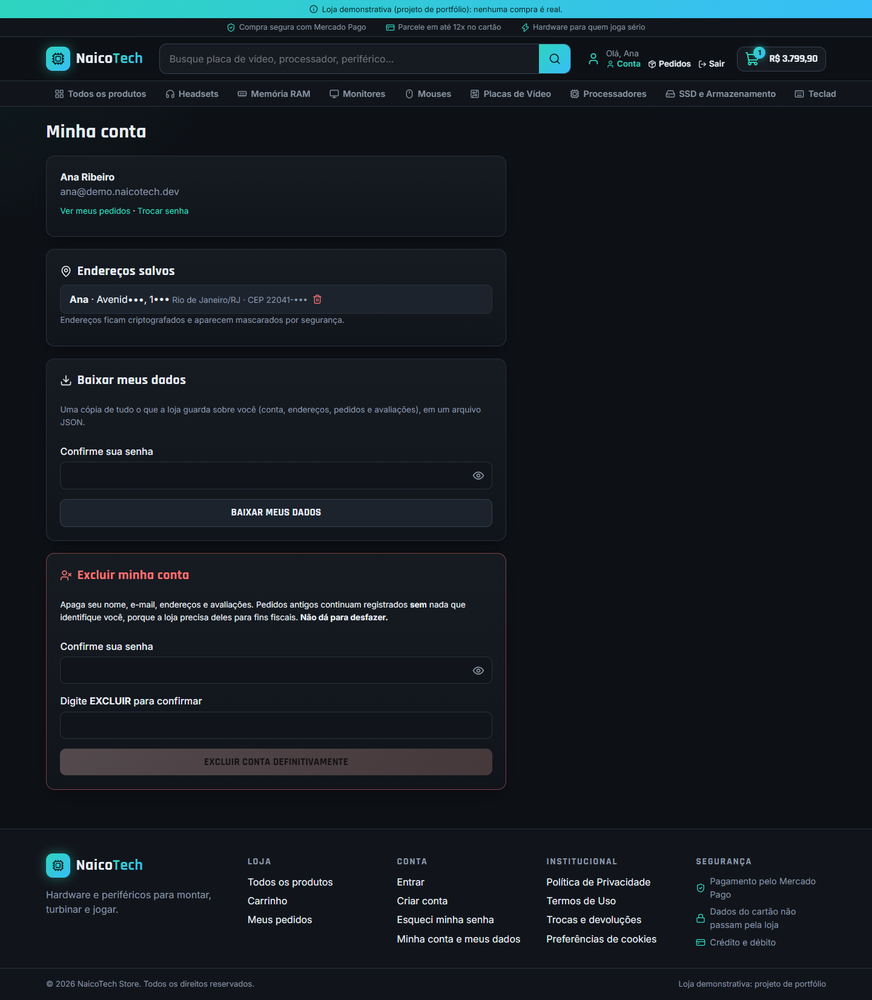
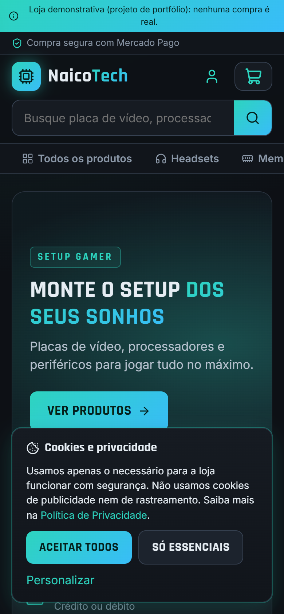

# NaicoTech Store

[](https://github.com/brunonverde/naicotech-store/actions/workflows/ci.yml)


[](LICENSE)

Loja virtual full-stack de hardware gamer: catálogo, carrinho, **pagamento com cartão (Mercado Pago)**, **cálculo de frete e etiquetas (Correios, Jadlog e outras via Melhor Envio)**, rastreio de pedidos e painel administrativo com **verificação em duas etapas**. Construída com foco em **segurança** e **LGPD**.

> **Projeto de portfólio.** Roda em modo de demonstração: pagamentos e frete em sandbox, nenhuma venda é real.

<details>
<summary><b>English summary</b></summary>

Full-stack e-commerce for PC hardware (React 19 + NestJS + PostgreSQL/Prisma). Card payments via Mercado Pago, real-time shipping quotes and label purchase via Melhor Envio (Brazilian carriers), order tracking with e-mail notifications, and an admin panel with mandatory TOTP 2FA and audit log. Security and privacy first: httpOnly cookie sessions with server-side revocation, CSRF protection, nonce-based CSP, rate limiting, AES-256-GCM encryption of personal data (addresses, IPs, 2FA secrets), data export/account deletion (Brazil's LGPD), and 144 automated tests running on CI.
</details>

## Telas

| Loja | Produto com frete calculado |
|---|---|
|  |  |
| **Checkout com endereço salvo e opções de frete** | **Pedido com rastreio** |
|  |  |
| **Painel admin: verificação em duas etapas** | **Painel admin: pedidos, etiquetas e rastreio** |
|  |  |
| **Minha conta: baixar e excluir dados (LGPD)** | **Celular, com o aviso de cookies** |
|  |  |

Mais: [catálogo com filtros](docs/screenshots/02-catalogo.png).

## Funcionalidades

**Cliente**
- Catálogo com busca, filtros por categoria, condição (novo/usado), preço e estoque.
- Cálculo de frete pelo CEP na página do produto e no carrinho (PAC, SEDEX, Jadlog...), com preenchimento do endereço pelo CEP.
- Pagamento com cartão de crédito ou débito, parcelado, pelo Mercado Pago.
- Página do pedido com andamento da entrega, código de rastreio e e-mails de "enviado" e "entregue".
- Cadastro com confirmação de e-mail, recuperação de senha, endereços salvos (opcionais) e avaliações de quem comprou.
- "Minha conta": baixar todos os dados pessoais e excluir a conta.

**Administrador**
- Painel protegido por verificação em duas etapas (app autenticador + códigos de recuperação).
- Cadastro de produtos (preço de custo, estoque, peso e medidas para o frete) e categorias.
- Pedidos: comprar e imprimir etiqueta, ver endereço completo sob demanda, atualizar rastreios.
- Registro de auditoria de todas as ações.

## Destaques técnicos

- **Nada que vem do navegador define valores:** preço dos produtos, frete e total são sempre recalculados no servidor; o webhook do Mercado Pago confere o valor pago com o total do pedido.
- **Pagamento à prova de clique duplo:** trava no pedido, chave de idempotência e tratamento de respostas incertas (timeout) sem cobrar duas vezes.
- **Etiqueta em 3 etapas com retomada:** se a compra da etiqueta falhar no meio, a próxima tentativa continua de onde parou, sem comprar de novo.
- **Dados pessoais criptografados:** endereço, CPF, telefone, IP e segredos de 2FA com AES-256-GCM, uma chave por finalidade e dado amarrado ao dono (copiar o valor para outra conta não abre). A API só devolve endereços mascarados.
- **Sessões revogáveis:** JWT em cookie `httpOnly` + `SameSite=Strict`, conferido no banco a cada requisição; sair ou trocar a senha derruba todas as sessões.
- **LGPD de ponta a ponta:** consentimento granular de cookies, aceite dos termos registrado, exportação e exclusão de conta, apagamento automático de endereços e IPs após o prazo, logs sem dados pessoais.
- **Testes:** 105 testes e2e no backend (contra um PostgreSQL de verdade, com Mercado Pago, Melhor Envio e e-mail simulados) e 39 no frontend, rodando no GitHub Actions.

Detalhes de segurança, riscos conhecidos e plano de resposta a incidentes: [`docs/SEGURANCA.md`](docs/SEGURANCA.md).

## Stack

| Camada | Tecnologias |
|---|---|
| Frontend | React 19, TypeScript, Vite, React Router, lucide-react, SDK do Mercado Pago |
| Backend | NestJS, TypeScript, Prisma, PostgreSQL, helmet, @nestjs/throttler, bcrypt, nodemailer |
| Integrações | Mercado Pago (Orders API + webhook), Melhor Envio (cotação, etiqueta, rastreio), ViaCEP |
| Testes | Vitest, Supertest, Testing Library |
| Infra local | Docker Compose (PostgreSQL + Mailpit para e-mails de teste), GitHub Actions |

```
backend/src
├── auth/        cadastro, login, sessão, confirmação de e-mail e recuperação de senha
├── admin/       painel, 2FA (TOTP próprio, RFC 6238) e auditoria
├── orders/      pedidos, expiração e pagamento
├── payments/    Mercado Pago e webhook
├── shipping/    frete, endereços criptografados, etiquetas e rastreio
├── account/     exportação e exclusão de dados (LGPD)
├── security/    criptografia, CSRF e tratamento de IP
└── products/ categories/ reviews/ mail/ config/
frontend/src     páginas, componentes, contextos (sessão, carrinho, consentimento)
```

## Como rodar

Requisitos: Node.js 24, Docker Desktop.

1. **Configuração.** Copie os exemplos e preencha:
   ```powershell
   Copy-Item .env.example .env
   Copy-Item backend\.env.example backend\.env
   Copy-Item frontend\.env.example frontend\.env
   ```
   - `.env`: uma senha forte em `POSTGRES_PASSWORD` (e a mesma em `DATABASE_URL` do `backend\.env`).
   - `JWT_SECRET`, `TOTP_ENCRYPTION_KEY`, `ADDRESS_ENCRYPTION_KEY` e `IP_ENCRYPTION_KEY`: valores **diferentes**, cada um gerado com
     `node -e "console.log(require('crypto').randomBytes(32).toString('hex'))"`.
   - Mercado Pago (credenciais de teste) e Melhor Envio (token do sandbox): veja os comentários no `backend\.env.example`.

   O backend se recusa a subir com variável faltando, valor de exemplo ou chave fraca.

2. **Banco e e-mail de teste:**
   ```powershell
   docker compose up -d
   ```
3. **Backend:**
   ```powershell
   cd backend
   npm ci
   npx prisma migrate deploy
   npm run seed        # produtos de exemplo
   npm run start:dev
   ```
4. **Frontend** (outro terminal):
   ```powershell
   cd frontend
   npm ci
   npm run dev
   ```
   Abra http://localhost:5173. Os e-mails (confirmação de conta, rastreio...) chegam no Mailpit: http://localhost:8025.

5. **Admin:** crie uma conta pelo site, confirme o e-mail e rode `npm run make-admin -- seu@email.com` em `backend/`. No primeiro acesso a `/admin`, o painel pede para configurar o app autenticador.

Cartões de teste do Mercado Pago e outros comandos: [`COMANDOS.md`](COMANDOS.md). Para publicar uma demo online grátis (Vercel + Render + Neon): [`docs/DEPLOY.md`](docs/DEPLOY.md).

## Testes

```powershell
cd backend;  npm run test:e2e   # cria e usa o banco naicotech_store_test
cd frontend; npm test
```

## Créditos das imagens

Fotos dos produtos de exemplo do [Wikimedia Commons](https://commons.wikimedia.org), usadas conforme as licenças:
[RTX 5060 Ti](https://commons.wikimedia.org/wiki/File:Nvidia_GeForce_RTX_5060_Ti_16GB,_PNY_Overclocked_Dual_Fan,_front.jpg) (FreeMediaKid!, CC BY-SA 4.0) ·
[RTX 4090](https://commons.wikimedia.org/wiki/File:Asus_Strix_RTX_4090_operational.jpg) (Benlisquare, CC BY-SA 4.0) ·
[Ryzen 7 1800X](https://commons.wikimedia.org/wiki/File:AMD_Ryzen_7_1800X.jpg) (Brian Wong, CC BY-SA 2.0) ·
[DDR4](https://commons.wikimedia.org/wiki/File:RAM_Module_(SDRAM-DDR4).jpg) (ElooKoN, CC BY-SA 4.0) ·
[Samsung 980 PRO](https://commons.wikimedia.org/wiki/File:Samsung_980_PRO_PCIe_4.0_NVMe_SSD_1TB-top_PNr%C2%B00915.jpg) (D-Kuru, CC BY-SA 4.0) ·
[SSD 2230](https://commons.wikimedia.org/wiki/File:A_2230_NVME_SSD.jpg) (User5515, CC0) ·
[EIZO FG2421](https://commons.wikimedia.org/wiki/File:EIZO_Foris_FG2421_VGA_computer_monitor_displaying_test_pattern.png) (Lucasbosch, CC BY-SA 4.0) ·
[Logitech G910](https://commons.wikimedia.org/wiki/File:Logitech-g910_(16475940137).jpg) (Sinchen.Lin, CC BY 2.0) ·
[Logitech G903](https://commons.wikimedia.org/wiki/File:2023_Mysz_komputerowa_Logitech_G903_Lightspeed.jpg) (Jacek Halicki, CC BY-SA 4.0) ·
[Headset](https://commons.wikimedia.org/wiki/File:RGB_gaming_headset_on_desk_with_ambient_lighting.jpg) (SankalpSasnur, CC0).
Marcas e nomes de produtos pertencem aos seus donos; os preços são fictícios.

## Licença

[MIT](LICENSE) © 2026 Bruno Verde
